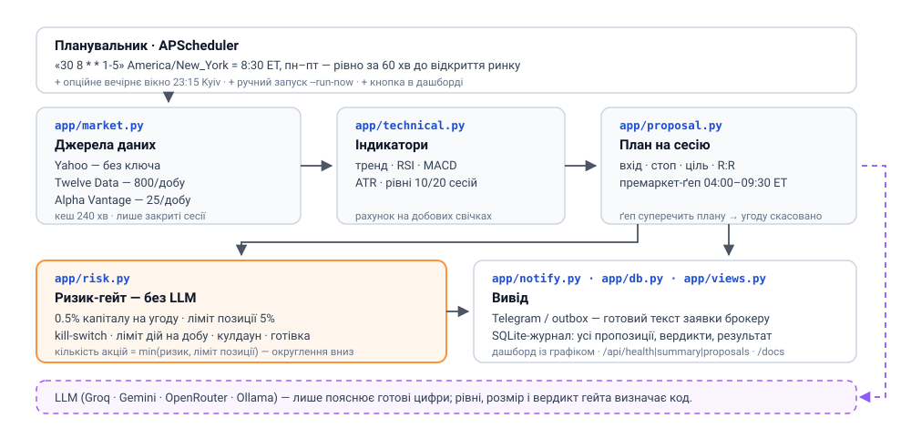

# Trading Assistant — пропозиції на наступну сесію (US-акції)

[](https://github.com/ВАШ-ЛОГІН/ta-assistant/actions/workflows/ci.yml)
[](LICENSE)
[](https://www.python.org/)

Помічник, який **за годину до відкриття американського ринку (8:30 за Нью-Йорком) готує конкретну
пропозицію на цю сесію** по кожній акції зі списку: напрямок, рівень входу, стоп, ціль, R:R, кількість акцій
і ризик у доларах — усе на добовому графіку (daily candles) і на **безкоштовних** джерелах даних.
Плюс перевірка нічного ґепу по премаркету: якщо ціна вже пішла проти плану — угода скасовується автоматично.

Ключове правило архітектури: **LLM (якщо його взагалі підключити) лише пише коментар. Усі цифри рахує код,
а детермінований ризик-гейт вирішує, чи взагалі пропозицію можна розглядати.** Ордери не виконуються —
рішення ухвалює людина.

```
[Yahoo/TwelveData/AlphaVantage — безкоштовно]      [LLM — опційно, безкоштовні тарифи]
                    │ добові свічки (лише закриті сесії)            │ коментар
                    ▼                                               ▼
      технічний аналіз (SMA/RSI/MACD/ATR, рівні 10/20/52) → правила сценарію
                    ▼
      премаркет-перевірка ґепу (8:30 ET) → ризик-гейт (код, без LLM) → розмір від ризику
                    ▼
      Telegram / дашборд / журнал    ← запуск за 60 хв до відкриття
```



## Розклад: за годину до відкриття

| Вікно | Коли | Навіщо |
|---|---|---|
| **pre_open** (типово) | **8:30 за Нью-Йорком, пн–пт** = за 60 хв до відкриття | план на **сьогоднішню** сесію + перевірка ґепу; ви встигаєте поставити заявку |
| after_close (опційно) | 16:15 ET (23:15 за Києвом) | попередній план на завтра, якщо зручніше ввечері |

```yaml
schedule:
  anchor: pre_open            # pre_open | after_close | both
  pre_open_cron: "30 8 * * 1-5"      # у таймзоні біржі
  market_timezone: America/New_York
```

Два підводні камені, які тут враховані:

1. **Таймзона біржі, не Києва.** США й Україна переходять на літній час у різні дати (березень і кінець
   жовтня). Якщо поставити «15:30 за Києвом», у ці кілька тижнів прогін з'їде на годину й потрапить рівно
   на відкриття. У таймзоні `America/New_York` 8:30 — завжди рівно 60 хвилин до відкриття, цілий рік.
2. **Нумерація днів тижня.** У бібліотеці APScheduler 0 = понеділок, у стандартному cron 0 = неділя, тому
   `CronTrigger.from_crontab("30 8 * * 1-5")` дає **вт–сб**: бот пропускав би понеділок і працював у суботу.
   У `app/scheduler.py` стоїть власний переклад cron-виразу, тому «1-5» — це справді пн–пт (це покрито тестами).

Що робить прогін за годину до відкриття:

- бере **лише закриті** добові сесії (сьогоднішня свічка ще не сформована — її не використовуємо);
- будує план на **сьогоднішню** сесію (а не на «наступний день після останньої свічки»);
- читає **премаркет** (04:00–09:30 ET) і рахує нічний ґеп:
  - ґеп у межах ±1% → «план чинний»;
  - ґеп угору понад 1% → лімітна заявка не виконається, потрібне рішення (ринок або новий рівень);
  - ґеп униз понад 2% → план застарів, рівні перераховуються;
  - премаркет **нижче стопу** → угоду скасовано автоматично, у Telegram приходить причина;
- пише в повідомленні, скільки хвилин лишилось до відкриття.

---

## Швидкий старт (без жодного ключа)

```bash
cd ta-assistant
pip install -r requirements.txt
python run.py --propose        # пропозиції на найближчу сесію по watchlist
python run.py                  # дашборд + планувальник (сам запуститься за годину до відкриття)
```

Добові свічки беруться з публічного API Yahoo **без ключа**, а коментар до пропозиції складає код із цифр
(`llm.provider: none`). Тобто базовий режим — **нуль витрат і нуль реєстрацій**.

Якщо мережа недоступна, кіт не падає: вмикається синтетичний ряд, і це **явно позначається** і в дашборді,
і в Telegram («ДЕМО-ДАНІ»). Для реальних рішень такий прогін використовувати не можна.

## Безкоштовні ключі (усе опційно)

| Що | Провайдер | Безкоштовно | Змінна в `.env` |
|---|---|---|---|
| Свічки | **Yahoo** (типово) | без ключа | — |
| Свічки (резерв) | Twelve Data | 800 запитів/добу | `TWELVEDATA_API_KEY` |
| Свічки (резерв) | Alpha Vantage | 25 запитів/добу | `ALPHA_VANTAGE_API_KEY` |
| Коментар | **Groq** | free tier, дуже швидко | `GROQ_API_KEY` |
| Коментар | **Google Gemini** | free tier AI Studio | `GOOGLE_API_KEY` |
| Коментар | **OpenRouter** | моделі з суфіксом `:free` | `OPENROUTER_API_KEY` |
| Коментар | **Ollama** | локально, без ключа | — |
| Макро (для TradingAgents) | FRED | безкоштовний ключ | `FRED_API_KEY` |

Приклад: щоб увімкнути безкоштовний LLM-коментар від Groq —
`llm.provider: groq` у `config.yaml` + `GROQ_API_KEY=...` у `.env`. Або зовсім без редагування файлів:

```bash
ASSISTANT_LLM_PROVIDER=groq GROQ_API_KEY=... python run.py --propose
```

Джерела пробуються по порядку з `data.sources`, поки якесь не відповість; результат кешується на
`data.cache_ttl_min` хвилин, щоб не витрачати безкоштовні ліміти.

## Скільком тікерам план, а скільком — угода

Типовий список — **20 акцій** (AAPL, AMD, AMZN, AVGO, COST, CRM, GOOGL, JPM, LLY, META, MSFT,
NFLX, NVDA, ORCL, QQQ, SPY, TSLA, UNH, V, XOM). Бот аналізує **всі** й на кожен дає вердикт:

| Що показує вердикт | Скільком | Що це означає |
|---|---|---|
| ✅ **BUY + дозволено гейтом** | 3 (ліміт) | готовий план і текст заявки, можна ставити |
| ⛔ **BUY, але гейт заборонив** | решта сетапів | план є, але впирається в ліміти (дій на добу, позицій, готівки) |
| ⚪️ **WAIT** | найбільше | сетапу немає — і це чесна відповідь, а не вигадана угода |

Тобто «20 позицій» — це **20 перевірених кандидатів**, а не 20 одночасних угод. Скільки входів
дозволено, вирішує детермінований гейт у `config.yaml`:

```yaml
risk:
  max_orders_per_day: 3      # скільки нових входів на добу (0.5% капіталу ризику кожен)
  max_positions: 8           # ліміт відкритих позицій
  risk_per_trade_pct: 0.5    # ризик на угоду, % капіталу
  daily_loss_limit_pct: 3.0  # kill-switch: денний збиток, після якого входи блокуються
```

Порахуйте перш ніж піднімати: 5 входів × 0.5% = 2.5% ризику на добу — ще в межах kill-switch 3%;
10 входів × 0.5% = 5% — це вже більше, ніж поріг зупинки. Саме тому типові значення помірні.

## Як будується пропозиція

1. **Дані.** Добові свічки за `lookback_days` сесій (420 ≈ 1.7 року), **тільки закриті сесії**.
2. **Техніка** (`app/technical.py`, чиста математика): SMA20/50/200, EMA21, RSI14 (за Вайлдером), MACD(12,26,9),
   ATR14, максимуми/мінімуми 10/20/52 сесій, співвідношення обсягу.
3. **Правила сценарію** (`app/proposal.py`):
   - BUY лише якщо тренд висхідний (ціна > SMA50 і SMA20 > SMA50), RSI у робочому діапазоні (типово 42–72)
     і імпульс не «мертвий» (MACD не суттєво негативний);
   - **ризик на угоду фіксований**: стоп ставиться на 1.5×ATR від входу і **ніколи не всередині** короткострокової
     структури (під мінімумом 10 сесій). Якщо структура вимагає глибшого стопу — тягнемо вниз **рівень входу**
     (лімітна заявка на відкат), а не розширюємо ризик. Якщо відкат виходить глибше 3×ATR — просто пропускаємо;
   - ціль — не менше ніж `min_rr` (типово 2.0) до ризику, і не нижче максимуму 20 сесій;
   - окремі відсічки: ATR > 6% (занадто волатильно), ризик на угоду > 8% від входу;
   - якщо сетапу немає — чесний **WAIT із причинами**, а не вигадана угода.
4. **Розмір позиції** (`app/risk.py`): `risk_per_trade_pct` (типово 0.5% капіталу) ділиться на відстань до стопу,
   потім береться менше з двох: ця кількість і ліміт `max_position_pct`.
5. **Ризик-гейт**: kill-switch за денним збитком, ліміт дій на добу, кулдаун на тікер, ліміт кількості позицій,
   перевірка готівки — усе детерміновано, без LLM.
   **План можна перебудувати безпечно:** прогін за годину до відкриття *переписує* вечірній план на ту саму
   сесію, а не конкурує з ним — попередні записи по цьому ж тікеру й сесії не враховуються ні в денному
   ліміті дій, ні в кулдауні (інакше раніший прогін блокував би власне оновлення).
6. **Премаркет-перевірка** (у pre-open прогоні): нічний ґеп, описаний у розділі «Розклад».
7. **Коментар**: LLM (якщо налаштований) або текст, складений із цифр. Рівні й розмір LLM не змінює.
8. **Вивід**: Telegram (з готовим текстом заявки для брокера, часом відкриття й ґепом) + запис у SQLite +
   сторінка з графіком у дашборді.

## Дашборд

| Сторінка | Що там |
|---|---|
| `/` | Картки стану, час **наступного автоматичного запуску**, таблиця пропозицій (вхід/стоп/ціль/R:R/розмір/вердикт гейта), кнопка «Підготувати пропозиції», список тікерів |
| `/proposal/{id}` | Повний план: **SVG-графік добових свічок із рівнями**, премаркет і ґеп, причини рішення, вердикт гейта, текст заявки з кнопкою копіювання, технічний паспорт, коментар |
| `/settings` | Джерела даних, стан LLM (який ключ потрібен), правила пропозиції, ліміти, портфель, тест Telegram |
| `/docs` | Swagger API: `/api/proposals`, `/api/propose`, `/api/watchlist`, `/api/book`, `/api/summary` … |

## Де дивитися результати

Результат роботи бота — це **план на найближчу сесію** (він же готовий текст заявки брокеру) плюс журнал
попередніх планів. Одні й ті самі дані доступні в кількох місцях:

| Канал | Що там | Як відкрити |
|---|---|---|
| **GitHub Actions → сторінка запуску** | «План підготовлено / пропущено», сесія, хвилин до відкриття, причина пропуску (вихідний, свято, поза вікном) і підсумкова таблиця в *Summary* | вкладка **Actions** → потрібний запуск |
| **GitHub Pages (сторінка результатів)** | те саме у вигляді сайту: таблиця планів, повний розбір по кожному тікеру з графіком, текст заявок, журнал сесій | `https://ВАШ-ЛОГІН.github.io/ta-assistant/` |
| **Артефакти запуску** | `results.md`, `results.json`, `outbox.log` — звіт і точні тексти повідомлень, які можна завантажити | той самий запуск → *Artifacts* |
| **Telegram** | готовий текст заявки брокеру + зведення плану (опційно, потрібен бот і токен) | `TELEGRAM_BOT_TOKEN` + `TELEGRAM_CHAT_ID` |
| **Локально** | дашборд, журнал, outbox — те саме, але на своїй машині/VPS | `python3 run.py` → `http://localhost:8000` · `data/assistant.db` · `data/outbox.log` |

### Результати на GitHub робочими діями (як у «грант-радара»)

Файл `.github/workflows/monitor.yml` запускає бота **за розкладом** і публікує результат, як у ботів,
що працюють на GitHub Actions: запуск → звіт у *Summary* → артефакти → **GitHub Pages** з готовою
сторінкою результатів.

```
schedule (UTC, пн–пт):  12:10 · 12:40 · 13:10 · 13:40
        │
        ├── ворота tools/gha_gate.py: за часом біржі (America/New_York)
        │   ├─ свято NYSE / вихідний            → пропуск
        │   ├─ поза вікном 07:50–09:05 ET       → пропуск (зайві вікна відсіюються)
        │   ├─ план щойно побудовано (< 45 хв)  → пропуск (щоб не дзвонити двічі)
        │   └─ у вікні                          → план на найближчу сесію + премаркет-ґеп
        ▼
   run.py --propose --force  →  tools/make_site.py  →  GitHub Pages + артефакти
```

Пастка, через яку це працює саме так: **GitHub виконує розклад у UTC і з затримкою** (зазвичай 3–20 хв).
Тому вікон чотири: улітку (EDST) 12:10 і 12:40 UTC — це 08:10 і 08:40 за Нью-Йорком, узимку (EST) те саме
роблять 13:10 і 13:40 UTC. Решта вікон просто відсіюються воротами, а свіжість плану захищає від
другого повідомлення того ж дня. Затримка до 50 хв не ламає план: він усе одно буде до відкриття.

Додаткові деталі для GitHub: **як увімкнути Pages, які секрети додати, як запустити вручну, чому звіт
лягає ще й у теку `results/`** — у [GITHUB.md](GITHUB.md), розділи 9 і 10.

## CLI

```bash
python run.py --propose                        # пропозиції на найближчу сесію (для cron)
python run.py --propose --tickers NVDA,AAPL    # вибірково
python run.py --propose --force                # ігнорувати кеш свічок
python run.py                                  # дашборд + планувальник (8:30 ET, пн–пт)
python run.py --settle                         # оцінити минулі рішення TradingAgents по alpha
python run.py --run-now                        # глибокий аналіз агентами TradingAgents (потрібен ключ LLM)
```

Якщо запускаєте через системний cron (а не через вбудований планувальник), теж задавайте час у таймзоні
біржі — інакше в перехідні тижні прогін з'їде на годину:

```cron
# /etc/crontab: CRON_TZ=America/New_York
30 8 * * 1-5 cd /шлях/до/ta-assistant && python run.py --propose >> data/cron.log 2>&1
```

Найпростіше — не використовувати системний cron, а лишити працювати `python run.py`: вбудований
планувальник уже налаштований правильно.

## Портфель

`data/book.json` має пріоритет над блоком `portfolio` у `config.yaml`:

```json
{
  "currency": "USD",
  "cash": 50000.0,
  "prev_close_equity": 49800.0,
  "positions": [{"ticker": "NVDA", "quantity": 5, "average_price": 175.0}]
}
```

`prev_close_equity` потрібен для денного P/L і kill-switch — оновлюйте його щоранку (або через `/settings`).
Позиції можна вести вручну: тоді SELL-сигнали стануть «закрити позицію», а BUY по наявному тікеру — «докупівлею».

## Глибокий аналіз агентами (опційно)

Кнопка на дашборді запускає повний конвеєр TradingAgents (аналітики + дебати + ризик-команда).
Для цього потрібні:

```bash
git clone https://github.com/TauricResearch/TradingAgents.git
cd TradingAgents && pip install . && cd ..
```

і ключ LLM (`OPENAI_API_KEY` тощо). Без них кнопка працює в mock-режимі — для перевірки обв'язки.

## Структура

```
ta-assistant/
├── run.py               # CLI: --propose, --run-now, --settle, дашборд
├── config.yaml          # джерела даних, LLM, правила пропозиції, ліміти, розклад
├── .env.example         # шаблон ключів (усі — безкоштовні тарифи)
├── LICENSE              # MIT
├── pytest.ini           # pytest: теки тестів, офлайновий режим
├── GITHUB.md            # як опублікувати цей код на GitHub
├── publish.sh           # перевірки + git init + перший коміт одним запуском
├── app/
│   ├── market.py        # добові свічки: Yahoo/twelvedata/alphavantage/synthetic, кеш, премаркет, календар сесій
│   ├── technical.py     # SMA/EMA/RSI/MACD/ATR і «паспорт» графіка
│   ├── proposal.py      # правила сценарію, рівні, розмір, вердикт, текст заявки
│   ├── risk.py          # детермінований гейт + size_by_risk
│   ├── chart.py         # SVG-свічки з рівнями, спарклайни
│   ├── llm.py           # коментар: none/groq/google/openrouter/ollama/…
│   ├── notify.py        # Telegram + outbox, формат пропозиції
│   ├── db.py            # SQLite: proposals / runs / outcomes / watchlist
│   ├── pipeline.py      # build_proposals, propose_one, глибокий аналіз
│   ├── scheduler.py     # cron за 60 хв до відкриття (таймзона біржі + переклад днів тижня)
│   ├── views.py         # HTML-сторінки (inline CSS, без зовнішніх ресурсів)
│   ├── web.py           # FastAPI
│   ├── engine.py        # адаптер TradingAgents + mock
│   ├── models.py        # Signal / RiskVerdict / RunRecord
│   └── settings.py      # config.yaml + .env
├── docs/
│   └── architecture.svg # схема вище
├── .github/workflows/
│   ├── ci.yml           # тести на Python 3.11/3.12/3.13, без ключів
│   └── monitor.yml      # розклад: план за годину до відкриття + публікація на GitHub Pages
├── dev/                 # заглушка TradingAgents для тестів
├── tools/
│   ├── gha_gate.py      # ворота запуску для GitHub Actions (час біржі, свята, антидубль)
│   └── make_site.py     # статичний сайт результатів (те, що публікується на GitHub Pages)
├── tests/               # 188 тестів: індикатори, ринки, пропозиції, розклад, премаркет, свята, ризик, API, сайт
└── data/                # створюється під час роботи: book.json, assistant.db, cache/, reports/
    └── book.example.json # зразок портфеля, який можна комітити
```

У репозиторій свідомо **не** потрапляють: `.env` (ключі), `data/assistant.db` (журнал угод),
`data/cache/` (кеш котирувань), `data/outbox.log`, `data/book.json` (ваш портфель) — усе це в `.gitignore`.

## Тести

```bash
python -m pytest tests -q     # 188 тестів, ~1 с, без мережі та без ключів
```

Покрито: індикатори на відомих числах, розбір відповідей усіх джерел, кеш і фолбек, календар сесій і
**свята NYSE** (переноси, Страсна п'ятниця, «наступне відкриття» не падає на вихідний), відсів
незакритої сесії, час відкриття й розклад (**включно з пастками DST і нумерації днів тижня**),
ворота запуску для GitHub Actions (усі чотири cron-вікна, антидубль, `--force`), премаркет і ґеп-логіка,
правила сценарію (вхід/стоп/ціль/R:R), розмір від ризику, усі гілки ризик-гейта, LLM (успіх/збій/немає ключа),
SVG-графіки, REST API, рендеринг сторінок і збірка статичного сайту результатів.

## Чого тут свідомо немає

- **Виконання ордерів** — це рівень B (брокер + ручне підтвердження). Тут тільки план і текст заявки.
- **Внутрішньоденної торгівлі** — горизонт добовий: свічки формуються раз на день.
- **Довіри LLM до цифр** — рівні, розмір і вердикт рахує код; LLM не має доступу до розрахунків.

## Публікація на GitHub

Код уже підготовлений до заливки: `.gitignore` відсікає ключі й дані середовища, є ліцензія та CI.
Покрокова інструкція (веб-інтерфейс, git CLI, gh CLI, гігієна секретів) — у [GITHUB.md](GITHUB.md).

```bash
./publish.sh https://github.com/ВАШ-ЛОГІН/ta-assistant.git   # перевірки → коміт → push
```

Після першого push: **Settings → Pages → Source: GitHub Actions** (один клік) — і бот почне
публікувати план щодня на `https://ВАШ-ЛОГІН.github.io/ta-assistant/`.

## Ліцензія

MIT — див. [LICENSE](LICENSE). Це дослідницький інструмент, а не інвестиційна порада.

## Дисклеймер

Інструмент для досліджень, не фінансова порада. Заявлена в статті TradingAgents дохідність не гарантується.
Перед реальними грошима — бектест і паперова торгівля. Помічник не виконує ордерів і не під'єднується
до брокерського рахунку.
